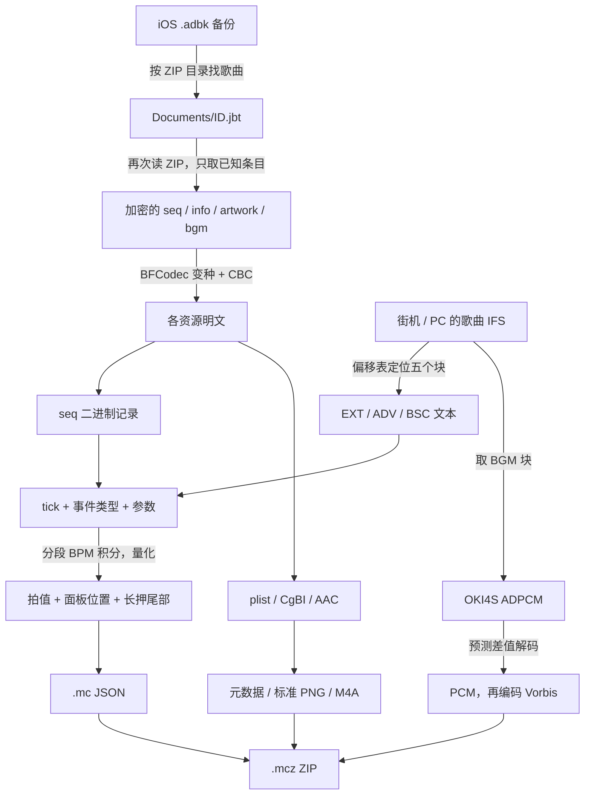

# 从文件字节到可读谱面：解包原理导读

“解包”在这里是几件工作的合称：**找到容器中的资源、还原资源字节、解释数据含义、转换为目标格式**。把这些阶段分开，就能知道每个数字从哪里来，以及出错时应该检查哪一步。

本文用人工构造的六条事件贯穿说明。所有十六进制、音频采样和图片像素示例都可由仓库代码生成，不需要真实游戏素材。它们演示当前实现，不能单独证明所有游戏版本都采用这个格式。

## 1. 先看两条处理链



| 阶段 | 它解决的问题 | 是否会改变资源的表达 |
|---|---|---|
| 容器读取 | 这一首歌、这个难度在哪一段字节里？ | 取出成员或切片；ZIP 自身可能需要解压 |
| 解密 | 怎么把不可读的密文恢复为原资源？ | iOS 已知条目需要；本工具的 IFS 流程没有这一步 |
| 解析 / 解码 | 哪些位表示时间、面板、颜色或声音？ | 二进制结构转事件，或压缩采样转 PCM |
| 转换 / 打包 | 怎样让目标查看器读取这些内容？ | 拍值量化、图片转换、可选音频转码，最后写 ZIP |

因此，改扩展名、普通解压、运行 ffmpeg 分别只能处理其中一部分。`ffmpeg` 不会解释 `seq_*`，也不负责 BFCodec 解密。

## 2. iOS：先剥两层 ZIP，再解每个资源

本工具支持的 `.adbk` 和里面的 `.jbt` 都能用 ZIP 读取器列目录。先在备份中找 `Documents/<ID>.jbt`，再读取里面的 `seq_ext`、`infov2`、`artwork` 等已知成员。ZIP 读取负责容器压缩；得到的成员字节仍有资源加密。

每个加密成员末尾有八个字节：前四个是明文长度，后四个是密文长度，均为大端整数。假设原文只有 ASCII `hello` 五个字节，人工样例会补到八个字节后加密：

```text
[8 字节密文] [00 00 00 05] [00 00 00 08]
              明文长度 5    密文长度 8
```

解密器先检查长度关系，再按每块八字节解密，最后只取前五字节。尾部长度不加密，也不送进分组解密器。真实填充字节的内容无需假定为某种标准 padding；人工示例使用零填充。

解密依靠游戏资源格式的固定密钥和固定 IV：按已整理的 BFCodec 算法执行即可，不需要逐文件猜密码。具体的 **F 函数为什么与普通 Blowfish 不同、P/S 表怎样展开、CBC 为什么要记住上一块密文**，见 [移动版：BFCodec 分解](mobile-format.md#bfcodec-变种)。

恢复明文后，下一步才按资源种类处理：`plistlib` 读元数据，`parse_seq` 读谱面，`cgbi_to_png` 处理图片，音频默认保留解密后的字节。

## 3. 街机 IFS：偏移表就是资源的地址簿

当前实现针对已经验证过的歌曲 `_msc.ifs` 布局，不是完整的通用 IFS 规格。文件 `0x10` 处的大端整数给出数据基准位置；前面紧邻五行索引，每行 12 字节。

人工示例的基准为 `0x80`：

```text
0x10: 00 00 00 80                       数据基准 = 128
索引开始 = 0x80 - 5 × 12 = 0x44
每行：相对偏移 BE32 | 块长度 BE32 | 第三个字段（当前不解释）
实际块地址 = 0x80 + 相对偏移
```

例如某行的相对偏移为 `0x30`，就从文件 `0xb0` 开始取该行指定数量的字节，不能把 `0x30` 当成文件绝对地址。五块依次是 BGM、试听、EXT、ADV、BSC。

其中三个谱面块已经是 CP932 文本：解析 `300,LONG,76880` 就得到了 tick 300 的长押事件。这里没有调用移动版的解密器。块边界、未解释字段及音频头见 [IFS 格式](arcade-format.md)。

## 4. 两种谱面怎样归一成相同事件

移动版的 `seq_*` 前 `0x60` 字节是头部，随后每条记录八字节。记录由两个小端 32 位整数构成：

```text
r0: [高 24 位：tick] [低 8 位：type]
r1: [32 位：value]

type = r0 & 0xff
tick = r0 >> 8
value = r1
```

“小端”是指低位字节先存。人工样例的第三条记录从 `0x70` 开始：

```text
字节：06 2c 01 00 | 50 2c 01 00
r0 = 0x00012c06  | r1 = 0x00012c50 = 76880
type = 6        | tick = 0x12c = 300
```

所以它等价于 IFS 文本的 `300,LONG,76880`。前者把字段压进整数，后者直接用逗号分隔，音符含义可以相同。

完整人工谱面如下；`END` 仅示范事件流结束位置，不会生成一个可按音符：

| tick | iOS type | IFS 指令 | value | 含义 |
|---:|---:|---|---:|---|
| 0 | 5 | TEMPO | 500000 | 初始 120 BPM |
| 0 | 1 | PLAY | 0 | 面板 0 单点 |
| 300 | 6 | LONG | 76880 | 面板 0 开始长押，持续 300 tick |
| 600 | 5 | TEMPO | 1000000 | 改为 60 BPM |
| 900 | 1 | PLAY | 2 | 面板 2 单点 |
| 1200 | 2 | END | 0 | 结束标记 |

## 5. 长押为什么能塞进一个整数

`value` 的不同位段存四项信息。以下是 **32 位整数的位布局**，不是文件内字节的排列顺序：

```text
31                        8 7     6 5     4 3          0
+--------------------------+-------+-------+------------+
| duration：持续 tick      |length |  dir  |   index    |
+--------------------------+-------+-------+------------+
          24 位               2 位    2 位      4 位
```

对 `76880 = 0x00012c50`：

```text
index     = value & 15         = 0
direction = (value >> 4) & 3   = 1
length    = (value >> 6) & 3   = 1
duration  = value >> 8         = 300
```

位置采用 `index = x + 4*y`。若在纸上把 y 正方向画向下，编号是：

```text
 0  1  2  3
 4  5  6  7
 8  9 10 11
12 13 14 15
```

`direction=1` 在当前转换器中对应坐标增量 `(0,+1)`；跨一格，终点便是面板 4。其他方向的增量为 `0:(0,-1)`、`2:(-1,0)`、`3:(+1,0)`。应按向量理解，避免把图形箭头朝向和长押终点方向混为一谈。

这个事件从 tick 300 开始，到 `300+300=600` 结束。持续时间和跨格数是两个独立字段，不能用“长押跨几格”推算“按多久”。

## 6. 为什么 tick 要先转秒，再转拍

原始时间刻度是 300 Hz，即 **300 tick = 1 秒**，一个 tick 约 3.333 ms。BPM 表示每分钟有多少拍。只在固定 BPM 段内，才可用 `拍数 = 秒数 × BPM / 60`。

人工谱面前两秒是 120 BPM，此后是 60 BPM：

```text
秒：  0          1          2          3          4
tick：0         300        600        900       1200
拍：  0          2          4          5          6
BPM：120 ------------------| 60 ------------------
```

所以 tick 900 的单点在第 5 拍：前两秒走了四拍，后面一秒再走一拍。若把三秒全部乘初始 BPM，就会错误地放到第 6 拍。

`_TimeMap` 在每个变速点保存 `(秒, 已累计拍值, 新BPM)`，查找事件所在段后计算：

```text
beat(t) = 该段起点拍值 + (t - 该段起点秒数) × 该段BPM / 60
```

代码用 `Fraction` 有理数避免中间计算累积浮点误差，并通过二分查找定位时间段。即使长押跨变速点，分别查起止时间再相减，也能算出正确的原始拍长。

### TEMPO 为什么不能只做一次除法

`TEMPO` 的整数 `v` 按 `floor(60000000 / BPM)` 解释，也就是一拍微秒数的整数截断。它不改变 300 Hz 的 tick 刻度。

例如 `v=333333`，直接相除会得到约 `180.00018000018`，而 180 BPM 本身也会存为 333333。符合这一整数的 BPM 是一个区间：

```text
60000000 / (v + 1) < BPM <= 60000000 / v
```

`value_to_bpm` 从整数开始，依次尝试更多小数位，只要截断回推仍落在该区间，就采用这个较短小数；最多尝试八位，之后退回精确比值。这是合理的**还原约定**，因为整数截断已经丢失信息，不能声称唯一找回了作者输入的 BPM。

### 1/48 拍是输出选择

转换器把拍值取为最近的 `1/48`：`Q(b) = round(48*b)/48`。这便于表达常见的二、三等分节奏，沿用了既有转换结果的粒度；它不是游戏原始时间单位。恰好在中点时沿用 Python `round` 的取偶数规则。

在固定 120 BPM、暂不考虑 BPM 还原及变速点量化的条件下，单个拍值的最大舍入误差是 `1/96` 拍，约 5.208 ms。不能因此宣称转成 `.mc` 后与原始 tick 逐点无损一致。

长押特别采用：

```text
输出头 = Q(原始头拍)
输出尾 = 输出头 + Q(原始尾拍 - 原始头拍)
```

这与“头尾分别取整”不总相同，尾部可能累计两个舍入误差。极短长押的拍长可能变成零，但仍保留 `endbeat` 和 `endindex`；否则会把长押变成单点并改变物量。

## 7. 最后写出的谱面是什么

`.mc` 是 JSON，拍值写作 `[整数部分, 分子, 分母]`，例如 `[2,1,3]` 表示 `2+1/3` 拍。上面人工谱面的核心字段是：

```json
{
  "time": [
    {"beat": [0, 0, 1], "bpm": 120},
    {"beat": [4, 0, 1], "bpm": 60}
  ],
  "note": [
    {"beat": [0, 0, 1], "index": 0},
    {"beat": [2, 0, 1], "index": 0, "endbeat": [4, 0, 1], "endindex": 4},
    {"beat": [5, 0, 1], "index": 2}
  ]
}
```

这里有三条音符记录，物量口径是两个单点加一个长押的头尾，共四。启用音频时，实际 `note` 数组还会有引用音频的事件，它不应被当成可按音符计数。

`.mcz` 则是 ZIP：把三难度 JSON 与可用音频、封面放进去，保证 JSON 引用的文件名真实存在。打包本身不会增加谱面精度，也不会实现游戏的判定窗口、marker 动画或输入延迟补偿。

## 8. 图片和声音各有一道还原

- **CgBI 图片**：解密后已经有 PNG 签名，但像素使用预乘 BGRA，压缩流也有区别。需要解行过滤、交换红蓝、解除 alpha 预乘并重写标准 PNG。例如 `[B=25,G=50,R=100,A=128]` 会恢复成约 `[R=199,G=100,B=50,A=128]`，透明度很低时的原始颜色不能精确找回。见 [CgBI 逐步解释](mobile-format.md#cgbi-png)。
- **iOS 音频**：已验证的 `bgm` / `index` 条目解密后可按 AAC/M4A 保存，默认不重编码。选择 `--transcode` 才转为有损 Vorbis。
- **IFS 音频**：`BMP\0` 在这里标识 Konami 音频。半字节记录的是相对前一采样的变化量，需要逐采样更新预测值和步长。初始状态下，立体声数据字节 `0x10` 对应左右采样 `96,32`；下一字节必须接着当前状态解。详见 [OKI4S 算法和手算](arcade-format.md#音频)。

## 9. 自己运行一遍，核对每个中间值

从仓库根目录运行：

```bash
python3 examples/walkthrough.py

# 没有 C 编译器时，可只跳过 C 解密步骤
python3 examples/walkthrough.py --skip-decrypt
```

脚本打印密文尾部、六条记录的十六进制、长押位段、BPM 与拍值、IFS 地址、单个音频采样、一个图片像素和 JSON。它调用真实转换器，并核对手算预期和两套解析结果。`--skip-decrypt` 会明确标出没有执行解密，不能把那次运行当作解密验证。

无需输入参数、游戏文件或 ffmpeg；人工 IFS 只放在自动清理的临时目录。完整运行可能生成忽略的 `.build/` C 编译产物。样例生成器位于 [tests/synthetic.py](../tests/synthetic.py)，没有预先藏好的游戏资源。

## 10. 怎样读代码，怎样判断结论可靠程度

| 想追的步骤 | 源文件和函数 |
|---|---|
| 双层 ZIP 和成员筛选 | [mobile/extract.py](../mobile/extract.py)：`extract_pack`、`process_song`、`bounded_read` |
| 编译、密钥初始化、C 调用 | 同文件：`load_lib`、`Decryptor` |
| 轮密钥、单块解密、CBC | [mobile/tools/jbf.c](../mobile/tools/jbf.c)：`keysetup`、`decblk`、`jbf_decrypt` |
| 二进制谱面与时间积分 | [mobile/extract.py](../mobile/extract.py)：`parse_seq`、`parse_chart`、`value_to_bpm`、`_TimeMap` |
| IFS 定位、文本谱面 | [arcade/import_ifs.py](../arcade/import_ifs.py)：`load_ifs`、`_parse_events`、`parse_chart` |
| ADPCM 状态更新 | 同文件：`parse_bmp_header`、`decode_bmp_to_pcm` |
| PNG 像素恢复 | [mobile/tools/cgbi.py](../mobile/tools/cgbi.py)：`_unfilter`、`cgbi_to_png` |
| 人工输入与断言 | [examples/walkthrough.py](../examples/walkthrough.py)、[tests/test_extract.py](../tests/test_extract.py) |

证据应分层看，不能把“能导出文件”当作全格式已破解：

| 结论来源 | 能说明什么 | 不能据此推断什么 |
|---|---|---|
| 历史 BFCodec 逆向记录 | 移动解密器整理自 Jubeat.app 3.9.11 行为 | 公开仓库没有完整反汇编过程，不能假装每个字段都有公开发现记录 |
| 当前源码和人工样例 | 可以复现这里的位运算、字节序、积分与转换过程 | 生成器和解析器可能共享同一错误假设；往返成功不独立证明官方格式 |
| 历史真实资源与本地抽查 | 已验证样本与既有转换结果相符 | 不保证全版本兼容，也不代表每次提交都重跑全量样本 |
| 标准算法文档 | 能核对标准 Blowfish / PNG 的定义 | 不能拿标准文档证明 BFCodec / CgBI 的私有差异 |

仍未完整解释的部分包括：`seq` 头部未使用字节、不同 magic 的版本语义、marker 位掩码的完整行为、IFS 每行第三个字段和通用 IFS 目录体系。当前转换只消费需要的字段；头部计数不能替代逐条音符统计。

部分检查也是工程取舍：`seq` 会检查长度但没有 magic 白名单；IFS 短于 32 字节的谱面块被当作占位是一条启发式规则；部分不合法文本行会跳过；长押终点坐标还没有完整的面板边界验证；PNG 输入 CRC 没有逐块验证。具体失败或忽略行为以实现为准，工具不是完整的格式校验器。

若继续研究新版本，应保存原始 tick 与原始字节，在本地对照多个难度的事件、音频时长和已知谱面，先验证候选规则再扩展解析器。不要为了“能跑完”静默套用未知字段。当前测试及真实样本检查范围见 [验证说明](validation.md)。
